# Circle

**Great talent. Close to you.**

A marketplace for booking local creative professionals, with separate Customer and Professional apps sharing one Expo / React Native codebase and a Supabase backend.

Makeup artists · Photographers · Video editors · Hair stylists · Content creators

[Architecture](#architecture) · [Customer journey](#customer-journey) · [Professional journey](#professional-journey) · [Payments](#payments-and-payouts) · [Animations](#animations-and-interactions) · [Run locally](#run-locally) · [Validation](#validation-and-release-status)

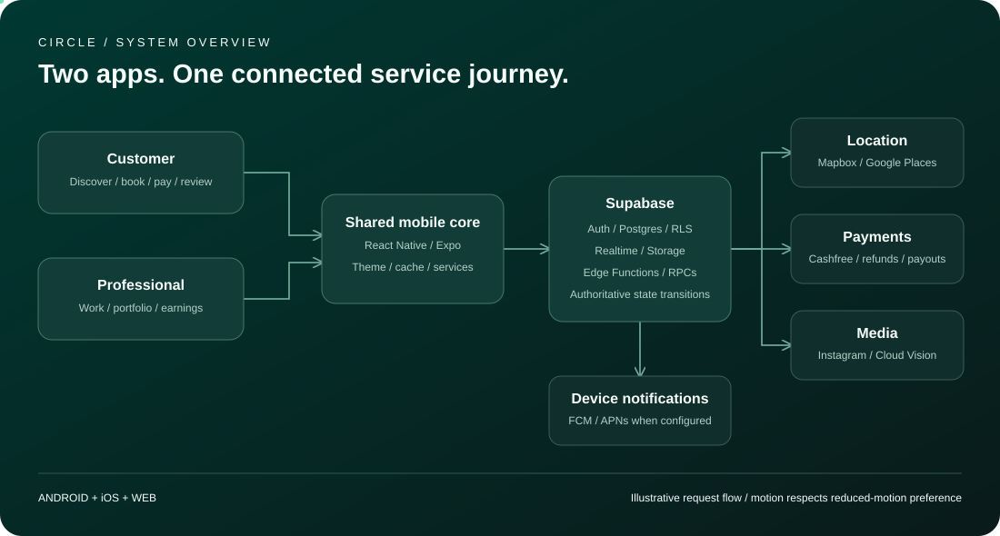

The architecture visual includes moving request markers when opened in a browser. GitHub may display a static version; [open the SVG](docs/diagrams/circle-architecture.svg) locally for motion. The Mermaid diagrams below render directly on GitHub.

## App preview

| Customer home | Professional analytics and team requests |
| --- | --- |
| 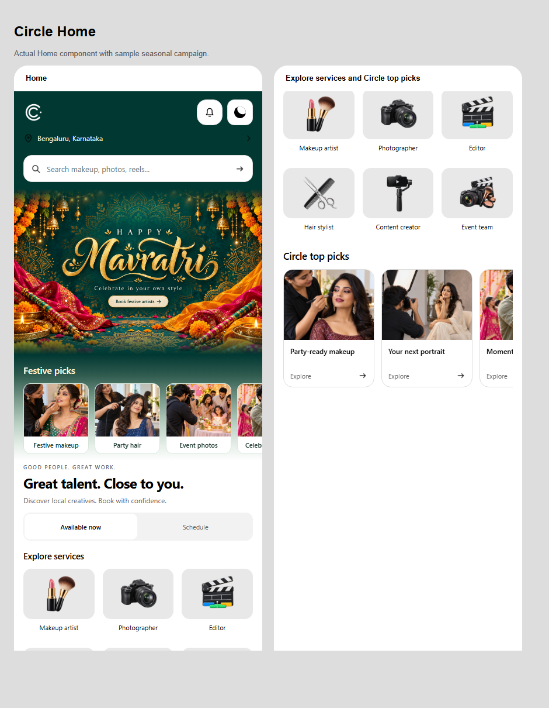 | 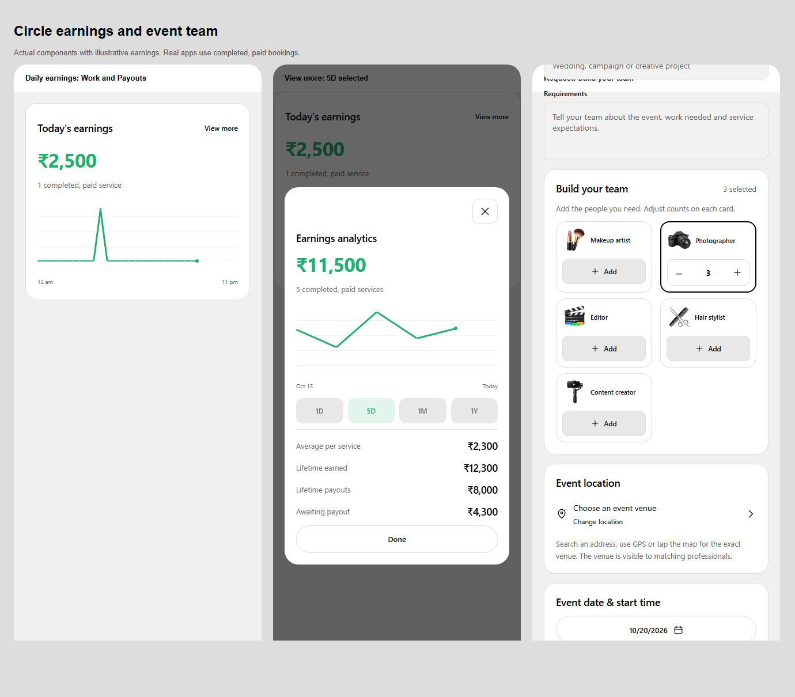 |

Preview screenshots use sample presentation data. Live availability, prices, reviews and earnings come from application records.

## What Circle includes

| Customer app | Professional app |
| --- | --- |
| Seasonal hero, festive picks and Circle top picks | Work dashboard and incoming requests |
| Service selection before nearby discovery | Online/offline availability control |
| Available now by default, or scheduled bookings | Service selection and per-session fees |
| Profiles with work grids, service cards and ratings | Profile photo, work samples and profile editing |
| Booking, payment, journey tracking and service OTPs | Accept requests, navigate, verify arrival/completion |
| Event teams with multiple people per craft | Earnings chart and payout history |
| Paid active-booking chat and review submission | Instagram connection badge and portfolio moderation |

Actor and dancer categories are hidden from the current service selection. Team requests support quantities of up to 20 per visible craft.

## Architecture

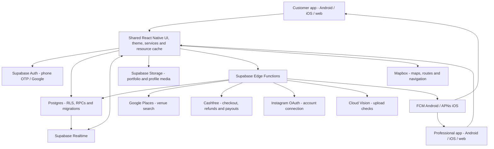

The two app variants have distinct package identifiers, callback schemes and build profiles. The backend validates bookings, payment transitions, availability and ownership. Client screens display server results; client-side controls do not establish payment success or permission to access another person's records.

### Code map

```text
mobile/
  App.tsx                  App startup, session and variant routing
  app.config.ts            Android/iOS configuration and app identity
  eas.json                 Role-specific development and release profiles
  assets/                  Campaigns, craft artwork, icons and branding
  src/components/          Shared profile, booking, chart and loading UI
  src/screens/             Customer and Professional screens
  src/lib/                 Supabase access, pricing, services and analytics
  tests/                   Mobile behavior and regression tests
supabase/
  migrations/              30 ordered schema and access-control migrations
  functions/               Payments, media, search and notification endpoints
  tests/                   Database and deployment checks
scripts/                   Deployment preparation and maintenance helpers
docs/                      Feature setup, operational notes and diagrams
artifacts/previews/        Review screenshots and validation records
artifacts/android/         Release metadata; APK binaries are excluded from Git
artifacts/ios/             Simulator metadata; archives are excluded from Git
```

### Edge Function responsibilities

| Function | Responsibility |
| --- | --- |
| `cashfree-order` | Authenticate the payer and create checkout for the server price snapshot |
| `cashfree-verify` | Recheck gateway payment state before recording payment |
| `cashfree-webhook` | Validate signed gateway events and reconcile booking state |
| `cashfree-beneficiary` | Register the professional's payout destination |
| `cashfree-payouts` | Process eligible payout jobs |
| `cashfree-refunds` | Process eligible refund jobs |
| `location-search` | Search and resolve venues through the server provider key |
| `portfolio` | Authorized account connection, media actions and upload checks |
| `portfolio-callback` | Complete provider OAuth callbacks |
| `notification-dispatch` | Dispatch eligible event notifications to registered devices |

## Customer journey

```mermaid
flowchart LR
    SignIn[Phone OTP or Google sign-in] --> Register[Complete account details once]
    Register --> Home[Home - season and top picks]
    Home --> Craft[Choose a profession]
    Craft --> Service[Choose a service]
    Service --> Timing{When?}
    Timing -->|Default| Now[Available now]
    Timing -->|Optional| Later[Choose a date and time]
    Now --> Nearby[Nearby eligible professionals]
    Later --> Nearby
    Nearby --> Profile[Work grid, about, prices and reviews]
    Profile --> Session[Select a service card]
    Session --> Request[Confirm venue and request booking]
    Request --> Accepted[Professional accepts]
    Accepted --> Lifecycle[Payment and service lifecycle]
    Lifecycle --> Review[Verified post-completion review]
```

Profiles show stable public usernames rather than professional legal names or phone numbers. The customer profile view places About above horizontal service cards, highlights the selected service and provides a rating distribution with a small review preview and View more.

## Professional journey

```mermaid
flowchart LR
    SignIn[Sign in] --> Details[Complete professional details]
    Details --> Services[Choose offered services and session fees]
    Services --> Portfolio[Upload profile photo and work samples]
    Portfolio --> Connect[Optional Instagram connection]
    Connect --> Online[Go online]
    Online --> Requests[Review incoming requests]
    Requests --> Accept[Accept a booking]
    Accept --> Journey[Start journey when payment rules allow]
    Journey --> Start[Verify customer start OTP]
    Start --> Work[Provide service]
    Work --> End[Verify customer completion OTP]
    End --> Earnings[Earnings and eligible payout]
```

Connecting Instagram currently establishes control of a connected account and displays the Circle tick badge. It does not certify identity, skill, qualifications or ownership of every portfolio image. Work samples are uploaded separately; account connection is not a required media-import step.

### Event team requests

```mermaid
flowchart LR
    Event[Event details and venue] --> Crafts[Choose craft cards]
    Crafts --> Count[Add or minus/plus count beside each craft]
    Count --> Publish[Publish request]
    Publish --> Apply[Professionals apply with a service]
    Apply --> Review[Customer reviews applicants]
    Review --> Confirm[Confirm selected professionals]
    Confirm --> Bookings[Individual bookings with availability checks]
```

Each craft has its own quantity. Reducing a quantity to zero removes that craft; adding photographers does not replace makeup artists already selected.

## Booking state and service verification

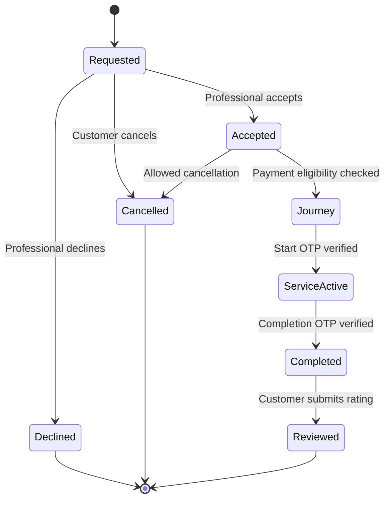

These are product lifecycle stages; internal database fields also track payment, travel, verification and payout state separately. Paid active-booking chat closes on completion, cancellation or decline; stored active chat messages are removed. Booking and financial records remain separate.

## Payments and payouts

### Fixed-price session

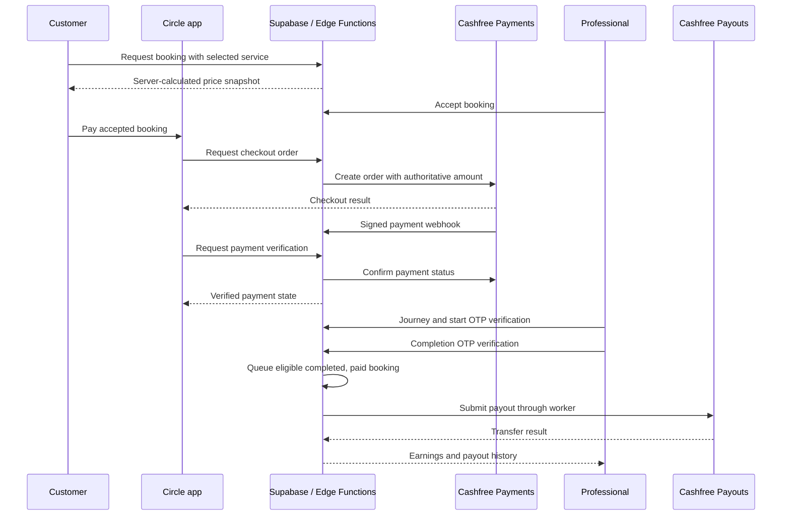

The customer pays the server-snapshotted total. The professional sees their agreed earnings. The booking/support fee is part of the customer total; its informational breakdown allocates 70% to platform fee and the rounded remainder to payment handling. This display allocation does not establish actual gateway costs, tax treatment or additional charges. The checkout total and professional entitlement remain unchanged.

Payout eligibility requires verified payment and completed service. A completed service, a queued payout and a confirmed paid transfer are distinct events. Worker scheduling, gateway configuration and settlement behavior must be validated for the target environment.

Wedding hourly bookings use a separate agreed-rate flow: start/end OTPs determine actual rounded-up hours, payment follows verified completion, and payout eligibility still requires confirmed payment. See [hourly billing](docs/wedding-hourly-billing.md).

### Earnings dashboard

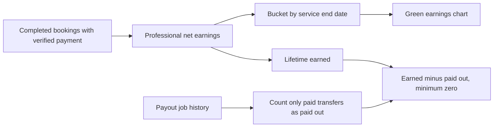

| Filter | Chart buckets |
| --- | --- |
| `1D` | 24 hourly buckets for today; default view |
| `5D` | Five daily buckets |
| `1M` | Thirty daily buckets |
| `1Y` | Twelve monthly buckets |

Legacy records without a service end date use their service date. Future records are excluded. Lifetime totals paginate records rather than silently stopping at the API row limit. Earnings, paid out, outstanding, processing and failed transfers remain distinguishable.

## Location and navigation

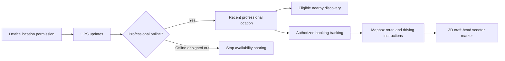

Mapbox handles maps, routes and navigation; Google Places handles typed venue search through an Edge Function. Discovery checks fresh, online, non-busy positions. Background sharing requires consent and native permissions; Android uses an ongoing location notification. Missing permissions, battery restrictions or force-stop can interrupt updates. See [live location](docs/live-professional-location.md) and [journey tracking](docs/background-journey-tracking.md).

## Media and account connection

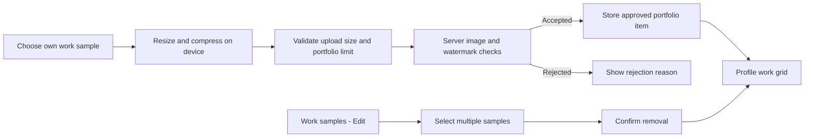

Portfolio uploads target less than 5 MB per image and up to ten samples. Compression balances image quality and size; it is not guaranteed to preserve every original detail. Server checks use the configured Cloud Vision integration for prohibited usernames, brand/company names, logos and watermarks. Automated checks can miss or misclassify content and do not prove authorship.

Instagram OAuth credentials and provider tokens stay on the server. Disconnecting is available after connection. Portfolio editing preserves the current screen instead of replacing it with a full-page refresh.

## Notifications and sessions

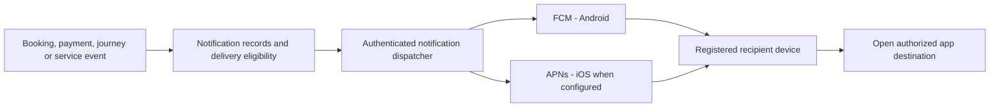

The bell is a clean notification settings entry; it does not show a history list. Android push has been configured. iOS delivery code exists, but APNs credentials, Apple membership and device validation remain required. A successful JavaScript export does not verify iPhone push delivery.

One active login is enforced **per app**: a newer Customer login replaces an older Customer session, while a Professional session can remain active separately. See [notification and launch setup](docs/notifications-and-circle.md).

## Animations and interactions

| Area | Behavior | Implementation |
| --- | --- | --- |
| Startup | Original Circle ring-tracing branded splash | Shared animated splash with startup deadline |
| Loading | Five craft illustrations bounce, scale and fade in sequence | `ServiceLoader`, React Native Animated |
| Appearance | Sun/moon theme control | Shared light/dark theme UI |
| Discovery and journey | Moving craft-head rider markers and follow camera | Mapbox and location interpolation |
| Seasonal home | Banner-matched color fades through white service cards | Native/web gradient styling |
| Service selection | Selected card border and corner tick | Shared service-card selection state |
| Work samples | Inline upload/removal feedback | Preserves existing gallery during mutations |
| Architecture visual | Request markers move between system layers | Local animated SVG with static fallback |

The service loader uses only the five active crafts, respects the device's reduced-motion setting and stops its animation when unmounted. Loading animations do not add artificial waiting time.

## Privacy and trust boundaries

- Public profiles use generated aliases; legal names, contact details and payout data have separate access rules.
- Row-level security and authenticated RPCs restrict access to private bookings, chat and financial records.
- Native sessions use secure device storage. Environment secrets and signing files are excluded from Git.
- Cashfree payment state is confirmed server-side; checkout callbacks alone cannot authorize service transitions.
- OAuth state and callback handling are server-side. Instagram connection is not proof of professional skill.
- Account deletion is currently support-assisted. Provider backups and required financial records may have separate retention requirements.

[Privacy policy](https://circle-policies-cclabs.web.app/) · [Local policy source](artifacts/privacy-site/index.html) · [Security review](docs/security-video-review.md)

## Run locally

Use a Node version compatible with the Expo SDK in `mobile/package.json` and install dependencies from the lockfile.

```powershell
cd mobile
npm ci
Copy-Item .env.example .env
# Fill the public app settings in .env locally.
npm run web:customer
# In another terminal, if needed:
npm run web:professional
```

For native development, configure the native providers and use a development client:

```powershell
cd mobile
npm run start:customer
npm run start:professional
```

Mapbox and Cashfree require native modules; Expo Go is not a substitute for the configured development client. See [native development](docs/native-development.md).

### Backend setup

1. Create and link your own Supabase project.
2. Configure phone OTP/SMS and Google sign-in with the correct callback URLs.
3. For a fresh deployment, review and apply `supabase/migrations/` in filename order. Existing deployments must apply only outstanding migrations. The initial prototype replacement is destructive and must not be replayed against a populated production project.
4. Populate server secrets from `supabase/.env.example` through the Supabase secret manager. Never place server secrets in `EXPO_PUBLIC_*` variables.
5. Deploy the Edge Functions, configure signed Cashfree webhooks and schedule the trusted payout/refund/notification workers as appropriate.
6. Configure provider OAuth redirects, storage rules, Cloud Vision, FCM and optionally APNs for the target environment.
7. Validate authentication, real provider callbacks, payments, refunds, transfers and notification delivery before public launch.

Do not commit `.env`, service-account JSON, private signing keys, keystores or account tokens. Example environment files contain placeholders and public configuration identifiers only.

## Build variants

```powershell
cd mobile
npx eas-cli@latest build --platform android --profile customer-apk
npx eas-cli@latest build --platform android --profile professional-apk
# Unsigned-for-iPhone simulator development builds:
npx eas-cli@latest build --platform ios --profile customer-simulator
npx eas-cli@latest build --platform ios --profile professional-simulator
```

EAS requires the project's Expo account and configured provider/build credentials. Simulator archives run in an iOS Simulator on a Mac; they cannot install on a physical iPhone. Signed physical-iPhone distribution requires the appropriate Apple developer setup.

Local native Android builds that share generated dependency output must run sequentially. Previous verification caught cross-variant embedded configuration from concurrent builds; each release must verify the embedded app role as well as its package name and signature.

## Validation and release status

Latest recorded validation: **19 October 2026**. See [release validation record](artifacts/previews/dashboard-request-validation.json).

| Check | Recorded result |
| --- | --- |
| Mobile regression suite | 134 passing tests |
| TypeScript | Passed |
| Android Customer | 0.1.9, version code 10; signed standalone APK verified |
| Android Professional | 0.1.14, version code 15; signed standalone APK verified |
| Embedded variant configuration | Verified separately for both APKs |
| Native modules and 16 KB alignment | Verified in release artifacts |
| iOS JavaScript exports | Both variants passed |
| Latest physical-device testing | Not performed for these release artifacts |
| Production store release | Not established by these checks |

APK and simulator binaries are deliberately excluded from source control. Release metadata remains in [Android artifacts](artifacts/android/) and [iOS artifacts](artifacts/ios/). Upload approved installable binaries through a distribution channel or GitHub Release separately.

```powershell
cd mobile
npm run typecheck
npm test

cd ../supabase
npm ci
npm test
```

Tests cover behavior including access rules, booking/payment transitions, pricing, portfolio editing, service selection, per-app sessions, earnings periods and multiple professionals per craft. Database tests emulate Supabase roles; they do not prove live gateway settlement or device behavior.

### Work before a public launch

Validate real-device navigation and payments, live refunds/payouts and worker scheduling; complete iOS signing/APNs setup; confirm SMS delivery and provider app-review access; review cancellation/refund and tax requirements; finish account-deletion operations, support/disputes, monitoring, backups and restore drills. Review accessibility and current dependency advisories for the release environment.

## Feature documentation

| Topic | Guide |
| --- | --- |
| Registration and public names | [Registration](docs/registration-and-names.md) |
| Team requests | [Team requests](docs/team-requests.md) |
| Service OTPs | [Service verification](docs/service-verification.md) |
| Portfolio and provider setup | [Social portfolios](docs/social-portfolios.md) |
| Search and venue providers | [Google Maps setup](docs/google-maps-setup.md) |
| Craft-head maps | [3D navigation](docs/craft-head-navigation.md) |
| iOS development | [iPhone and simulator builds](docs/iphone-builds.md) |

Some older feature notes describe historical rollout stages. The current source and the dated validation record above establish the latest implemented behavior and tested limits.

---

Operated by **CC Creative Labs** · [support@cclabs.space](mailto:support@cclabs.space)
