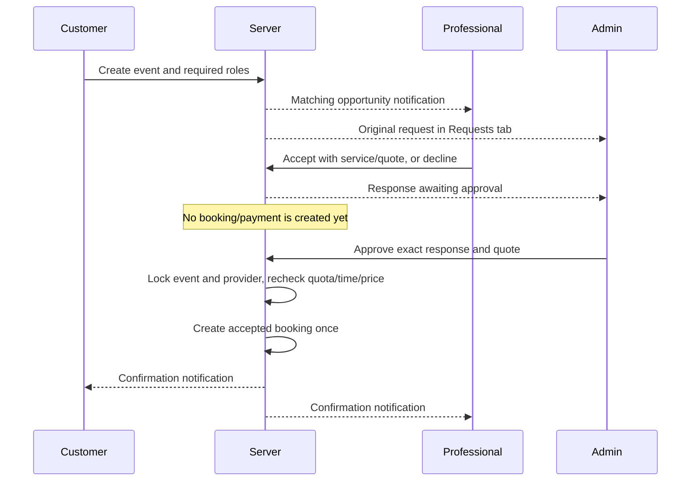

# Professional discovery and bulk approval

Implemented in source on 31 October 2026. This release needs a coordinated backend and app rollout; the source changes do not update installed APKs automatically.

## Discovery and registration

- Every newly published/updated professional profile needs a real full name, registered home address and confirmed map pin.
- Public names are derived on the server from the registered first name. Client-provided aliases are ignored. Common profession/promotional keywords, links and numeric names are rejected. Keyword checks do not establish legal identity; admins must review unfamiliar business-like names.
- Home addresses and precise base coordinates are stored in `professional_home_locations`, readable only by their owner and authorized admins. Public profiles, offline markers and offline distance calculations use rounded coordinates (two decimal places).
- Discovery supports 5 km and 10 km, includes online and offline professionals together, and orders online/available professionals first. Fresh live positions take precedence; offline/busy professionals use approximate registered bases. Pins and cards identify Online, Busy and Offline.
- Existing professionals have no inferred home address: they must provide it in Update professional details. Going online without a registered base fails with an actionable message. No home address is fabricated from a prior GPS fix.
- Photographers must enter lenses, lighting kits, backup cameras, backup memory cards and equipment pricing. Photo/video software multi-selects depend on craft/editing services; relevant software is checked by the publishing RPC and later Editor service changes.
- Map selection supports debounced location suggestions, selecting a result to recenter, adjusting the pin and explicitly confirming it. Search is confined to location-selection maps.

## Bulk requests

Admin Requests includes original event details, requested headcounts, professional acceptances/declines and approve/reject controls. It refreshes every 30 seconds while visible. Only explicitly allowlisted verified admins can review responses; customer selection cannot confirm them. Admin approval retries are idempotent, and approval rechecks active services, price, scheduling conflicts and remaining headcount. Fixed and hourly billing keep their existing payment/OTP rules after confirmation. Push delivery still depends on device consent, registered tokens and the existing dispatch job.

## Portrait review

Profile uploads add Google Vision face and scene checks to existing text/logo checks. No face, multiple faces, low-confidence faces, obvious wedding scenes/illustrations/advertisements or branding are rejected. Accepted uploads remain pending for manual review and are visible only to their owner/admin until approval. These checks do not recognize identity, prove liveness or detect all stolen photos.

Admins review the exact photo path alongside the full profile. A replacement invalidates the previous badge/review. Stale admin reviews cannot approve replacement bytes. Existing explicitly reviewed photos keep their reviewed state; other legacy portraits await review. Profile rejection hides that photo publicly. Signed image links already issued can persist until expiry/deletion.

## Rollout

1. Prepare updated Customer, Professional and Admin builds together.
2. Apply `supabase/migrations/202610310001_professional_discovery_bulk_approval.sql` through the normal incremental migration workflow. Do not run the initial-deployment bundle on the existing database.
3. Deploy the updated `portfolio` Edge Function. Keep `GOOGLE_CLOUD_VISION_API_KEY` server-only; its existing Vision API configuration is reused for face/label checks.
4. Release updated clients/admin. Older APKs cannot complete new registration requirements and retain their old labels until updated.
5. Collect registered bases and missing equipment/software from existing professionals. Review pending portraits in Talent.
6. Redeploy the hosted privacy notice from its updated local source.

Rollout completed on 31 October 2026: migration 202610310001 applied to the linked project, portfolio Edge Function deployed, production access checks passed, and all three 0.2.1 APKs generated with unchanged packages/certificates. The updated Firebase privacy policy was published and its public contents verified on 31 October 2026: https://circle-policies-cclabs.web.app.
